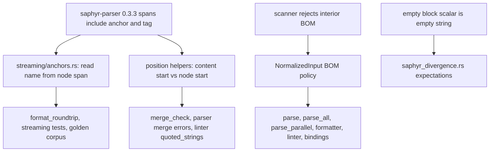

---
aliases:
  - saphyr 0.3 migration plan
tags:
  - sdd
  - plan
  - dependencies
  - parser
created: 2026-11-02
status: implemented
related:
  - "[[spec]]"
  - "[[constitution]]"
---

# Technical Plan: Migrate to saphyr-parser 0.3.x

> [!info] References
> **Spec**: [[spec]]
> Unresolved: OQ-1..OQ-7 in the spec. Steps 1, 2 (investigation half) and 4 do not depend on them; OQ-2 is decided (a: follow saphyr 0.3.3, see spec FR-005); step 5 partly on OQ-3/OQ-4.

## 1. Architecture

### Approach

Bump `saphyr-parser` to 0.3.3 in the workspace `Cargo.toml` (single pin, `saphyr-parser = { version = "0.3.3" }`; used by `fast-yaml-core` and `fast-yaml-linter`) on a branch that already contains dependabot's `Cargo.lock` change, then fix the 59 failures class by class, re-running the saved list after each step to measure progress. The order is chosen so each step removes a large, mechanically explained group before the judgment calls: anchors first (about 40 tests plus most of the "misc" group), then BOM (policy), then empty block scalars (expectation flips), then the residual triage, then documentation.

Alternative considered: pin 0.2.2 and ignore dependabot. Rejected: 0.3.x fixes real bugs (flow mapping state in compact pairs, empty block scalar, BOM rejection) and holding back accumulates a larger migration later.

### Component diagram



### Key Design Decisions

| Decision | Choice | Rationale | Alternatives Considered |
|----------|--------|-----------|------------------------|
| Anchor recovery | Read `&name` from the node's own span, only when the event's anchor id is non-zero | Events say whether an anchor exists, so a scalar like `a &b` cannot be misread; no gap and no `prev_end` bookkeeping needed for names | Keep gap search and extend it to the node span (more code, same ambiguity); patch saphyr (out of scope) |
| Span semantics for positions | Add one helper that returns the content start by skipping leading properties (anchor, tag, comments, whitespace) and use it where 0.2.2 positions were observable | One place for the rule (DRY); preserves diagnostics that users and yamllint parity depend on | Accept property-start positions (changes goldens and parity; only with OQ-3 decision) |
| BOM policy | Decided OQ-2 (a): adopt saphyr's interior-BOM rejection; no pre-processing in `NormalizedInput` | Principle 2 (one implementation) and 3 (parity) | Per-surface handling (rejected by principle 2) |
| Empty block scalar | Adopt upstream `""` | Upstream is now correct for EOF; parity of `parse_all` and `parse_parallel` is restored | Re-add `"\n"` in fy (rejected: carries a workaround for a fixed bug) |
| Alias limits | Unchanged, fy-owned | Principle 4; the saphyr guard is unverified (OQ-1) and must not be relied on | Rely on saphyr guard (rejected) |

## 2. Project Structure

```
Cargo.toml                                        # saphyr-parser 0.2.2 -> 0.3.3
Cargo.lock
crates/fast-yaml-core/src/streaming/anchors.rs    # step 1
crates/fast-yaml-core/src/streaming/formatter.rs  # call sites ~L450, L463 (advance, name_before)
crates/fast-yaml-core/src/position.rs             # content-start helper (step 1b)
crates/fast-yaml-core/src/merge_check.rs          # step 1b
crates/fast-yaml-core/src/parser.rs               # steps 1b, 3
crates/fast-yaml-core/src/input*.rs               # NormalizedInput, step 3 (path to confirm)
crates/fast-yaml-linter/                          # quoted_strings, golden corpus
crates/fast-yaml-parallel/tests/saphyr_divergence.rs   # step 4
CHANGELOG.md, specs/001,002,003,005,009, specs/cross-feature-open-questions.md   # step 6
.local/testing/{journal,coverage-status,regressions}.md  # live test results
```

## 3. Data Model

`AnchorNames` after step 1 (sketch; final shape decided during implementation):

```rust
impl<'a> AnchorNames<'a> {
    /// Name of the anchor written in the properties of the node whose event has `span`.
    pub(super) fn name_in(&mut self, span: Span) -> Option<&'a str>;
}
```

`advance` and `prev_end` are removed if no remaining caller needs them (document-start handling was the only reason for the special case). `ByteCursor` stays: it converts a `SourcePosition` to a byte offset in one forward pass; the cursor must stay monotonic, so conversions use span starts in event order.

### Migrations
None (no persisted data). Breaking changes go to CHANGELOG (pre-1.0 policy, no shims).

## 4. API Design

No public API change planned. Possible user-visible effects: BOM errors (OQ-2), empty block scalar value, diagnostics columns (OQ-3). Python and Node.js bindings only forward these.

## 5. Integration Points

| System | Direction | Protocol | Notes |
|--------|-----------|----------|-------|
| saphyr-parser 0.3.3 | inbound | Rust events (`Event`, `Span`) | Only crate used; the separate `saphyr` loader crate is not a dependency |
| dependabot PR #691 | process | git | Rebase onto it or supersede and close it |
| Issue #470 | process | GitHub | Close report 2, keep report 1 open or split |

## 6. Security

- Resource limits stay fy-owned (spec 009 FR-012); run the alias-bomb, deep-nesting and scan-ahead tests unmodified.
- Re-verify the #586 scan-ahead guard, #543 tag-escape and #544 `BufferedInput`/`StrInput` guard tests against 0.3.3.
- OQ-1 resolution: run a direct event loop on a billion-laughs document with 0.3.3 and record whether saphyr stops it; keep the result in `.local/testing/`.
- `cargo deny check advisories licenses` after the bump.

## 7. Testing Strategy

| Level | Framework | What to Test | Coverage Target |
|-------|-----------|-------------|-----------------|
| Unit | nextest | `anchors.rs` (new name-from-span cases: tag before/after anchor, anchor on empty node, document-root anchor, comments between properties, multibyte), position helper | every branch of the new code |
| Integration | nextest | `format_roundtrip`, `streaming_format_regressions`, `merge_errors`, `parse_all_parity`, `saphyr_divergence`, linter goldens | all 59 green |
| Suite | yaml-test-suite harness | xfail list after the bump; verify it shrinks or is unchanged and explained | no new unexplained xfail |
| Manual E2E | `fy`, Python, Node.js | formatting with anchors, merge keys, BOM cases, empty block scalar, alias bomb | per spec SC-004; log in `.local/testing/journal.md`, reset rows in `coverage-status.md` to Untested first |
| Cross-binding | CLI, `maturin develop`, `npm run build` | identical result for anchors, BOM, empty scalar (NFR-004) | all three agree |
| CI | `mise run ci` plus `lint:clippy-hack`, `test:core-no-arena`, MSRV, `MISE_ENV=py310/py314/node22` | full gate | green |

Baseline: save the scratch failure list (`/private/tmp/claude-501/-Users-rabax-Dev-fast-yaml/895c5bf6-ebde-459b-be5e-1a419923d8bc/scratchpad/saph-fails.txt`) into `.local/testing/` and diff after each step.

## 8. Performance Considerations

- Anchor recovery becomes cheaper (slice of one node span instead of an inter-event gap).
- Compare `cargo bench` for parse and format before and after; investigate OQ-5 (`a_megabyte_of_repeated_names_loads_fast`) on the 0.2.2 baseline under identical load before treating it as a regression.

## 9. Rollout Plan

1. Branch `fix/{issue}-saphyr-parser-0-3` from `main` via `EnterWorktree`; create the tracking issue with `P2` and `enhancement` labels and assign it.
2. Steps below land as separate commits in one PR (the bump is atomic: nothing is green in between, so one PR, reviewable commit-per-step).
3. PR closes the tracking issue and, per FR-011, #470 report 2 (state in the PR what is excluded, and file the follow-up for report 1 immediately); close dependabot #691 as superseded or rebase onto it.
4. Release: separate decision (OQ-7).

### Ordered migration steps

| Step | Work | Spec refs | Depends on | Exit check |
|------|------|-----------|------------|------------|
| 0 | Bump pin and lockfile, build, save baseline failure list | US-003 | none | 59 failures reproduced |
| 1 | `anchors.rs`: take the name from the node span (gate on non-zero anchor id); update `formatter.rs` call sites; add unit tests | FR-001..003 | 0 | all class A tests pass; remaining E tests re-listed |
| 1b | Add content-start helper in `position.rs`; use it in `merge_check`, `parser` merge errors and the linter `quoted_strings` rule where 0.2.2 positions must be kept; resolve OQ-3 first | FR-004 | 1, OQ-3 | class B tests pass or are deliberately changed with spec and CHANGELOG |
| 2 | Re-run the whole suite; triage the residual (class E) one by one: fix, update with reason, or file issue; resolve OQ-4 (goldens) and OQ-5 (timing) | FR-009 | 1, 1b | only classes C and D fail |
| 3 | BOM policy decided (OQ-2 = a, interior BOM is an error, no `NormalizedInput` pre-processing); update the roughly 10 pinned tests (`bom_elsewhere_is_content`, `test_mid_text_bom_stays_data`, `test_parse_all_strips_only_one_of_double_bom`, CLI `test_double_bom_strips_only_one`, formatter BOM escaping, `anchor_with_bom_is_idempotent`, `parse_all_parity`) | FR-005..007 | 2, OQ-2 | BOM tests agree with the policy on every surface |
| 4 | Flip empty-block-scalar expectations in `saphyr_divergence.rs`; keep `marker_after_block_scalar_with_explicit_indent_indicator_errors_only_in_saphyr` as the documented report-1 divergence (adjust if 0.3.3 changes its outcome) | FR-008, FR-011 | 2 | those 3 tests green with comments updated |
| 5 | OQ-1 and OQ-6 verification: alias-bomb event loop and `fy` run; yaml-test-suite xfail refresh; re-verify #586/#543/#544 guard tests | FR-010, FR-012, NFR-002 | 2 | recorded result; xfail list explained |
| 6 | Docs: CHANGELOG `[Unreleased]` (one line each: BOM, empty block scalar, any position change, saphyr bump; PR link after creation), specs 001/002/003/005/009 and `cross-feature-open-questions.md`, `.local/testing/` journal, coverage-status and regressions | FR-013, US-002 | 3, 4, 5 | docs match behavior |
| 7 | Full gate (`mise run ci` plus extras), manual E2E on all three surfaces, `cargo +nightly fmt`, clippy, rustdoc; open PR; update #470 and file follow-up for report 1; remove assignees from excluded issues | SC-001..005 | 6 | CI Success green |

## 10. Constitution Compliance

| Principle | Status | Notes |
|-----------|--------|-------|
| 1 Type safety | Compliant | Reuse `SourcePosition`, `OneBased`; no stringly-typed positions; the content-start helper returns `SourcePosition` |
| 2 One implementation | Compliant | BOM policy and anchor recovery stay in `fast-yaml-core` |
| 3 Surface parity | Compliant (to verify) | Cross-binding check, NFR-004 |
| 4 Bounded by default | Compliant | Limits remain fy-owned (FR-010) |
| 5 No silent data loss | Compliant | OQ-2 = (a): an interior BOM is rejected with a position, never dropped silently |
| 8 Safe Rust | Compliant | No unsafe |
| 9 Quality gate | Required | Step 7 |
| 10 Pre-1.0 | Compliant | Breaking changes in CHANGELOG, no shims |

## 11. Risks and Mitigations

| Risk | Impact | Probability | Mitigation |
|------|--------|-------------|------------|
| Span rule differs for some node kinds (collections, empty scalars, document root, aliases) | high (wrong anchor names) | medium | Unit tests per node kind; run the full anchor/alias test list and a fuzz-style round-trip (`format(format(x)) == format(x)` plus alias binding check) |
| Stricter BOM handling rejects files fy accepted | medium | medium | Accepted by the user (OQ-2 = a); CHANGELOG entry; error with position |
| Undocumented upstream changes alter parse results in untested corners | high | low-medium | yaml-test-suite run, regressions.md replay, cross-binding E2E |
| Believing an alias guard exists when it does not | high | medium | OQ-1 verification; keep fy limits authoritative |
| Golden corpus regenerated blindly | medium | medium | Inspect diff first (OQ-4); only anchor-position or intended changes |
| Dependabot PR conflicts with this branch | low | high | Supersede and close #691 |

## See Also

- [[spec]] — feature specification
- [[MOC-specs]] — all specifications
